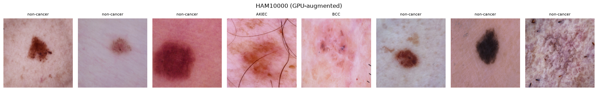
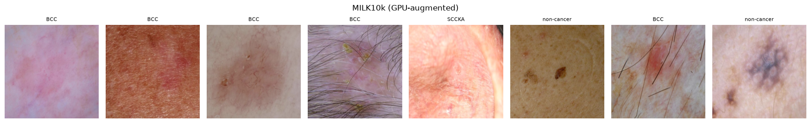
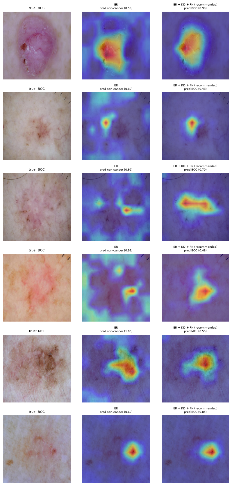

<div align="center">

# CancerIL-Skin

### Continual learning for skin-lesion classification

[](https://www.python.org/)
[](https://pytorch.org/)
[](canceril_skin_continual_learning_pipeline.ipynb)


**Cancer-class expansion from HAM10000 to MILK10k, with external validation on DDI.**



<sub>Representative GPU-augmented HAM10000 samples generated by the notebook.</sub>

</div>

---

## Overview

CancerIL-Skin is a GPU-accelerated experimental pipeline for studying how skin-lesion classifiers retain existing knowledge while learning new cancer classes. The project combines reproducible continual-learning experiments, rigorous statistical evaluation, interpretability analysis, and paper-ready outputs in one notebook.

| Stage | Dataset | Role |
|:--|:--|:--|
| **Stage 1** | HAM10000 | Train the initial skin-lesion classifier |
| **Stage 2** | MILK10k | Expand the classifier with additional classes and domains |
| **External validation** | DDI | Evaluate cross-domain performance and skin-tone fairness |

<div align="center">
  
  <br>
  <sub>Representative MILK10k samples used during class expansion.</sub>
</div>

## What is included

- **Two continual-learning settings:** class-and-domain incremental (CDI) and strict class-incremental learning
- **Strong baselines:** LwF, EWC, Experience Replay, DER++, joint training, and a Stage-1-only reference
- **CancerIL variants:** knowledge distillation, prototype preservation, cancer false-negative penalties, and rehearsal combinations
- **Multiple backbones:** EfficientNet-B3, ConvNeXt-Tiny, and Swin-T
- **Robust evaluation:** multi-seed confidence intervals, paired significance tests, AUROC, sensitivity at fixed specificity, and per-class forgetting
- **Mechanistic analysis:** linear CKA representation drift and Grad-CAM attention maps
- **Paper outputs:** publication-ready tables, figures, ablations, and automated findings checks

## Model interpretability

The notebook compares where a standard Experience Replay model and the recommended CancerIL objective focus when examining difficult cancer cases.

<div align="center">
  
  <br>
  <sub>Grad-CAM comparison on challenging BCC and melanoma samples. Warmer regions indicate stronger model attention.</sub>
</div>

## Notebook

The full workflow lives in:

> [`canceril_skin_continual_learning_pipeline.ipynb`](canceril_skin_continual_learning_pipeline.ipynb)

It covers data preparation, GPU caching and augmentation, training, hyperparameter selection, checkpointing, inference, statistical analysis, figures, and exportable research artifacts.

## Requirements

| Component | Requirement |
|:--|:--|
| Python | Python 3 |
| Compute | CUDA-capable NVIDIA GPU |
| Core ML | PyTorch and torchvision with CUDA support |
| Data science | NumPy, pandas, SciPy, scikit-learn |
| Imaging and plots | Pillow, Matplotlib |
| Environment | Jupyter Notebook or JupyterLab |

Install the CUDA-compatible PyTorch build for your system first. Then install the remaining dependencies:

```bash
pip install numpy pandas pillow matplotlib scipy scikit-learn tqdm jupyter
```

> [!IMPORTANT]
> This pipeline is GPU-only and stops when CUDA is unavailable. Its default configuration is optimized for an NVIDIA RTX 4070 SUPER with 12 GB of VRAM.

## Datasets

The datasets are not distributed with this repository. Download and prepare them separately according to their respective licenses and access requirements:

- **HAM10000** — initial training and old-class evaluation
- **MILK10k** — new-class and cross-domain continual learning
- **DDI** — external validation and skin-tone analysis

Update these paths in the notebook's configuration cell before running:

```python
HAM_ROOT = r"path/to/HAM10000"
MILK_ROOT = r"path/to/MILK10k"
DDI_ROOT = r"path/to/DDI"
BASE_OUTPUT = Path(r"path/to/outputs")
```

## Quick start

1. Clone this repository and open the notebook in Jupyter.
2. Configure the four local paths shown above.
3. Set `SMOKE_TEST = True` and run all cells.
4. Confirm the end-to-end smoke test finishes successfully.
5. Set `SMOKE_TEST = False` for the complete experiment suite.

> [!TIP]
> Full experiments are computationally intensive, but runs are resume-safe. Finished checkpoints and results remain on disk, so interrupted sessions can continue without repeating completed work.

## Reproducibility

- Independent seeds vary Stage-1 initialization, MILK10k splits, Stage-2 initialization, and sample order.
- Hyperparameters are selected using validation data only.
- Lesion grouping is used when metadata is available to reduce train-validation leakage.
- Predictions, splits, checkpoints, metrics, tables, and figures are saved under the configured output directory.
- Threshold-free and operating-point metrics are reported together to avoid relying on a single decision threshold.

## Responsible use

> [!WARNING]
> This repository contains research code, not clinical software. It must not be used for diagnosis, treatment decisions, or direct patient care. Users are responsible for dataset licensing, privacy, bias assessment, and appropriate ethical review.

---

<div align="center">
  <sub>Built for reproducible research in continual learning and computational dermatology.</sub>
</div>
